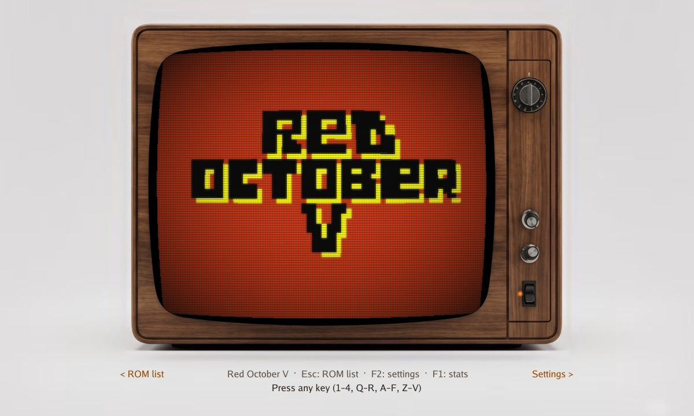

# Chippie

A CHIP-8 emulator that runs in your browser, presented as a mid-1970s CRT
television. Turn the channel dial to change games: around 300 CHIP-8,
SUPER-CHIP and XO-CHIP games and demos are downloaded straight from public
archives, so you never have to find a ROM file yourself.

**[▶ Play Chippie in your browser](https://rbscholtus.github.io/chippie/)**



Chippie is written entirely in Go with [Ebitengine](https://ebitengine.org),
including the UI and the CRT shader, and compiled to WebAssembly.

## Features

- **Seven CHIP-8 platforms**: the original COSMAC VIP CHIP-8 and its 64×64
  Hires mode, modern CHIP-8, CHIP-48, SUPER-CHIP 1.0 and 1.1, and XO-CHIP,
  each with its own quirks.
- **The right settings for each game**: platform, quirks, speed, colours
  and screen rotation come from the community
  [chip-8-database](https://github.com/chip-8/chip-8-database). You can
  change any of them.
- **A built-in library** of about 300 games, demos and test programs. Search
  it, filter it by platform, or load a ROM of your own.
- **A 1970s TV**: three cabinets to choose from, working knobs, and a CRT
  shader with curvature, scanlines, bloom and phosphor afterglow (which also
  hides CHIP-8's sprite flicker).
- **Works on phones and tablets**, with an on-screen remote for the hex
  keypad.
- **Nothing to install.** Games you've played are cached and work offline.
- **Accurate:** every platform is checked against the
  [Timendus CHIP-8 test suite](https://github.com/Timendus/chip8-test-suite)
  with pixel-exact screenshot tests.
- **Instruction trace** for the curious: the last instructions executed,
  disassembled for the active platform.

## How to play

1. Open [Chippie](https://rbscholtus.github.io/chippie/) and press any key,
   or tap the screen, to switch the TV on.
2. Open the **ROM list** (Esc, or "< ROM list" under the TV) and pick a game.
   It downloads, "tunes in", and starts.
3. Play with the keyboard, or the on-screen remote on a touch screen.

### The TV's controls

Click or tap a knob to turn it one step, drag it, or use the mouse wheel.

| Control | What it does | Key |
|---|---|---|
| Power switch | Switches the TV off and pauses the game; any key switches it on again | P |
| Channel dial | Next or previous game in the ROM list (following your search and filter) | PageUp / PageDown |
| Fine-tuning knob | Emulation speed (instructions per frame), saved per game | `[` / `]` |
| Volume knob | Volume; all the way down mutes | `-` / `=` |
| Tint knob | The game's own colours, white, amber, green or Octo colours, saved per game | T |
| "< ROM list" | The game library | Esc |
| "Settings >" | Platform, speed, quirks, TV skin, instruction trace | F2 or Tab |
| Stats | Shows the actual updates and frames per second, the scale and the window size at the top of the page | F1 |

### The keypad

CHIP-8 computers had a 16-key hex keypad. Chippie maps it to the left of
your keyboard:

```
Keyboard        CHIP-8 keypad
1 2 3 4         1 2 3 C
Q W E R    →    4 5 6 D
A S D F         7 8 9 E
Z X C V         A 0 B F
```

Under the TV, Chippie shows which keys the running game uses. Where
chip-8-database knows a game's controls, it lists them (and the on-screen
remote highlights them). Otherwise Chippie watches the game: every key it
checks is added to a "Keys it reads" line, and lit on the remote, so after
a few seconds of play you can see its controls. A game that waits for any
key says so.

### The library

- **Search** by title, author, year or platform. Every word must match, and
  part of a word is enough. Platform words include `chip8`, `chip-8`,
  `modern`, `vip`, `cosmac`, `chip48`, `chip-48`, `schip`, `superchip`,
  `super-chip`, `xo`, `xochip`, `xo-chip`, `hires` and `64x64`.
- **Filter** by platform with the chips under the search field.
- Games for platforms Chippie can't run yet are listed under **Coming soon**.
- **Load your own ROM** with "Load a ROM from this device", or drag a file
  onto the page.
- **Kept up to date:** each time it starts, Chippie fetches the latest
  chip-8-database in the background, so game details and recommended
  settings stay current. A weekly job refreshes the built-in copy of the
  database and looks for new download locations; new games appear once
  that update is merged.

### Settings

Settings (F2 or Tab) apply to the game that's running and are saved for it:
platform, speed, each quirk, and **Reset to recommended** to go back to the
database's values. Settings also has the TV skin and the instruction trace.

## Supported platforms

| Platform | Screen | Status |
|---|---|---|
| CHIP-8 (COSMAC VIP, 1977) | 64×32 | ✅ Playable |
| 2 Page Display for CHIP-8 (COSMAC VIP, 1978; "Hires CHIP-8") | 64×64 | ✅ Playable: the 8 known ROMs |
| Modern CHIP-8 | 64×32 | ✅ Playable |
| CHIP-48 (HP48, 1990) | 64×32 | ✅ Playable |
| SUPER-CHIP 1.0 and 1.1 (HP48, 1991) | 64×32, 128×64 | ✅ Playable, with an optional legacy HP48 mode |
| XO-CHIP (Octo, 2014) | 64×32, 128×64, 4 colours | ✅ Playable, with sound patterns |
| CHIP-8 with machine code (VIP) | 64×32 | Not yet |
| MEGA-CHIP (2007) | 64×32, 128×64, 256×192, 256 colours | Not planned: hardly any ROMs |
| CHIP-8X (RCA, 1980) | 64×32, colour | Not planned: hardly any ROMs |

**What are quirks?** Every CHIP-8 interpreter since 1977 has behaved a little
differently: whether shifts use `VX` or `VY`, whether `I` changes after a
load or store, whether sprites wrap at the screen's edges, and so on. Games
written for one interpreter often break on another. Chippie picks the
platform and quirks for each game from chip-8-database, falls back to modern
CHIP-8 for ROMs it doesn't know, and lets you change any of them in Settings.
The [Timendus quirks test](https://github.com/Timendus/chip8-test-suite#quirks-test)
explains each one.

## Where the games come from

Chippie doesn't copy games into its own build: it downloads each one from its
original home and checks it against the SHA-1 hash in chip-8-database.

| Source | Licence |
|---|---|
| [chip8Archive](https://johnearnest.github.io/chip8Archive/) (John Earnest, Octojam games) | CC0 |
| [kripod/chip8-roms](https://github.com/kripod/chip8-roms) | none stated; each game belongs to its author |
| [Octojam games from itch.io](https://github.com/maxisimonazzi/chip8-emulator), via maxisimonazzi/chip8-emulator | none stated; each game belongs to its author |
| [Matthew Mikolay's CHIP-8 programs](https://github.com/mattmikolay/chip-8) | MIT |
| Timendus's [CHIP-8 test suite](https://github.com/Timendus/chip8-test-suite) and 3D mazes | GPL-3.0 |
| 18 ROMs from [Zophar](https://www.zophar.net/pdroms/chip8.html) and [David Winter's page](https://www.pong-story.com/chip8/), hosted by Chippie because browsers can't download them there | public domain / freeware ([attribution](web/hosted-roms/README.md)) |

A few CC0 games are built in, so there is something to play before anything
has downloaded. [docs/coverage.md](docs/coverage.md) has the current numbers.

Chippie also gives back: games and fixes it found are proposed upstream to
chip-8-database and the test suite ([docs/upstream/](docs/upstream/README.md)).

## Roadmap

**Done:** the emulator core for seven platforms with screenshot tests, the
browser app, the library and download sources, SUPER-CHIP, XO-CHIP, the 1970s
TV with touch support, the upstream contributions (milestones M1–M8), and
the COSMAC VIP's 64×64 2 Page Display ("Hires CHIP-8"), with its 8 known ROMs (M10).

**Next:**

- **Depot**, an XO-CHIP game of our own, bundled with Chippie (M9).
- Getting the 2 Page Display and its ROMs into chip-8-database ([#34](https://github.com/chip-8/chip-8-database/pull/34)).
- Arrow keys for games whose controls are known.
- Favourite games, and one library entry per program.

The full list, with open questions, is in [docs/ROADMAP.md](docs/ROADMAP.md).

## Building from source

You need Go 1.27 and Python 3 (the browser build script and the local web
server use it). For the browser tests, also Node.js.

```sh
git clone --recurse-submodules https://github.com/rbscholtus/chippie
cd chippie

go run ./cmd/chippie          # native window: the quickest way to try changes
go test ./...                 # unit and screenshot tests

./scripts/build.sh            # browser build into web/dist/
cd web/dist && python3 -m http.server 8080
```

Before contributing, read [CONTRIBUTING.md](CONTRIBUTING.md). How Chippie is
built, and why, is in [docs/DESIGN.md](docs/DESIGN.md).

## CHIP-8 resources

**Learn about CHIP-8**

- [CHIP-8 on Wikipedia](https://en.wikipedia.org/wiki/CHIP-8)
- [CHIP-8 Technical Reference](https://github.com/mattmikolay/chip-8/wiki/CHIP%E2%80%908-Technical-Reference), Matthew Mikolay
- [Guide to making a CHIP-8 emulator](https://tobiasvl.github.io/blog/write-a-chip-8-emulator/), Tobias V. Langhoff
- [Writing an emulator in JavaScript (CHIP-8)](https://www.taniarascia.com/writing-an-emulator-in-javascript-chip8/), Tania Rascia
- [CHIP-8 variant opcode table](https://chip8.gulrak.net/), Gulrak: every opcode across the variants
- [XO-CHIP specification](https://johnearnest.github.io/Octo/docs/XO-ChipSpecification.html), John Earnest
- [CHIP-8 extensions and compatibility](https://chip-8.github.io/extensions/): the CHIP-8 family tree and how the variants differ
- [CHIP-8 Extensions Reference](https://github.com/mattmikolay/chip-8/wiki/CHIP%E2%80%908-Extensions-Reference), Matthew Mikolay: the historical variants, with their sources
- [CHIP-8 Reference (CHIP-8-KB)](https://chip8kb.gulrak.net/reference/), Gulrak: opcodes, quirks and variants in depth (some pages still in progress)

**Test and metadata**

- [Timendus CHIP-8 test suite](https://github.com/Timendus/chip8-test-suite) (Chippie uses v4.2)
- [CHIP-8 database](https://chip-8.github.io/database/) ([repo](https://github.com/chip-8/chip-8-database)): platforms, quirks and metadata for every known ROM

**Games and tools**

- [chip8Archive](https://johnearnest.github.io/chip8Archive/): CC0 games from the Octojam game jams
- [Octo](https://johnearnest.github.io/Octo/): a CHIP-8 assembler and IDE in the browser
- [Cadmium](https://github.com/gulrak/cadmium): a CHIP-8 emulator for many variants, useful to compare behaviour
- [Octojam on itch.io](https://itch.io/jam/octojam-10): the yearly CHIP-8 game jam
- [kripod/chip8-roms](https://github.com/kripod/chip8-roms) and [Zophar's CHIP-8 PD ROMs](https://www.zophar.net/pdroms/chip8.html): the classic games; kripod's [`hires/`](https://github.com/kripod/chip8-roms/tree/master/hires) folder has the 64×64 Hires CHIP-8 ROMs and how to run them

## Credits and licence

Chippie is BSD 3-Clause licensed ([LICENSE](LICENSE)). Every bundled or
hosted asset (ROMs, fonts, the AI-generated TV artwork) is listed with its
origin and licence in [assets/LICENSES.md](assets/LICENSES.md).

Thanks to the chip-8-database maintainers, Timendus for the test suite, John
Earnest for Octo and chip8Archive, and every author whose game you can play
here.
