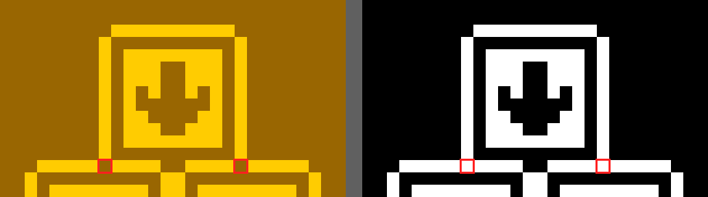

# Draft 04: two pixels in the scrolling test's reference pictures

- **Where:** issue on [Timendus/chip8-test-suite](https://github.com/Timendus/chip8-test-suite).
- **Status:** draft, waiting for review.
- **Background:** Chippie's golden frames come from the suite's pictures
  (`cmd/golden-import`), which corrects exactly these four pixels
  (`loresBorderFixes`, `hiresBorderFixes`); see the M5 commit `743e18d`.

## How it was verified (2026-11-15)

1. **Chippie's frame:** the suite's `8-scrolling.ch8` (v4.2) run in Chippie's
   emulator core, headless and without the CRT effect: SUPER-CHIP, modern,
   with `0x1FF` set to 1 (lo-res) and 3 (hi-res), the same as choosing them
   in the menu, for 600 frames. The frame is saved at its native size
   ([lo-res](04-scrolling/lores-chippie-64x32.png),
   [hi-res](04-scrolling/hires-chippie-128x64.png)).
2. **The suite's pictures:** `pictures/lores-scrolling.png` and
   `hires-scrolling.png` (768×384, so 12 and 6 screen pixels per CHIP-8
   pixel), read back onto the same grid at the centre of each block, without
   `cmd/golden-import`'s corrections.
3. **Compared pixel by pixel:** exactly four pixels differ, all lit in
   Chippie and off in the pictures: (26, 15) and (37, 15) in lo-res,
   (58, 32) and (69, 32) in hi-res. All other pixels match (2046 and 8190).
4. **Which one is right:** the test's own code (below) draws each of those
   pixels exactly once, so they must be on.
5. **Cadmium agrees with Chippie** (checked by the owner, 2026-11-15):
   [Cadmium](https://github.com/gulrak/cadmium) v2.0.0-8cd178c in its
   `STRICT-SCHIP-1.1` mode, the HP48 interpreter that SUPER-CHIP legacy
   targets, shows both corners lit
   ([screenshot beside Chippie](04-scrolling/cadmium-vs-chippie-schip11-legacy.png),
   [close-up of the corners](04-scrolling/cadmium-corners.png)). The suite's
   README names Cadmium as one of its validation tools, and its author,
   Gulrak, checked the suite on real HP48s. That run is the legacy lo-res
   variant; the borders are drawn by the same routine after the scrolling in
   both variants, so they must look the same in each.

Close-ups, the suite's picture on the left and Chippie on the right, the
four pixels boxed in red:

Full-size differences, in the test rig's diff colours:
[lo-res](04-scrolling/lores-diff.png), [hi-res](04-scrolling/hires-diff.png).

## Review checklist

- [x] Checked against the test's source at `v4.2`
  (`src/tests/8-scrolling.8o`, lines 163–200 and 236–273): the four pixels
  are drawn exactly once, and nothing else is drawn there.
- [x] The pictures on `main` are the same files as in `v4.2` (same git
  hashes), so the gaps are still there.
- [x] No existing issue about it (searched "scrolling" and "pixel").
- [x] Re-verified pixel by pixel, with screenshots (above).
- [x] Confirmed in Cadmium (`STRICT-SCHIP-1.1`) by the owner.
- [ ] Text below approved.

## The issue

**Title:** Scrolling test: two border pixels shown off in `lores-scrolling.png` and `hires-scrolling.png`

**Body:**

> Thanks for the test suite! While importing your reference pictures as
> pixel-exact golden frames for my emulator, I found four pixels that I
> think are drawn wrong in the pictures, not in the emulator.
>
> In `pictures/lores-scrolling.png`, the pixels at (26, 15) and (37, 15)
> are off: the two corners where the upper box's sides meet the line below
> it. But in
> [`scrolling-draw-borders-lores`](https://github.com/Timendus/chip8-test-suite/blob/v4.2/src/tests/8-scrolling.8o#L163-L200),
> the upper box's sides are drawn at x = 26 and x = 37 on rows 5–14 only,
> and row 15 is drawn by the two lines at x = 21–30 and x = 33–42. So each
> of those two pixels is XOR-drawn exactly once and should be on. The
> arrows end up inside the boxes and don't reach them.
>
> `pictures/hires-scrolling.png` has the same gaps at (58, 32) and (69, 32):
> [the hi-res borders](https://github.com/Timendus/chip8-test-suite/blob/v4.2/src/tests/8-scrolling.8o#L236-L273)
> draw the sides at x = 58 and x = 69 on rows 22–31, and row 32 with the
> lines at x = 53–62 and x = 65–74.
>
> Close-ups, your picture on the left and my emulator's frame on the right,
> with the four pixels boxed:
>
> 
>
> 
>
> Cadmium agrees: in its `STRICT-SCHIP-1.1` mode (v2.0.0-8cd178c, legacy
> lo-res), both corners are lit as well. Close-up of its two corners:
>
> 
>
> (That's the legacy variant; the borders are drawn by the same routine
> after the scrolling, so they look the same in the modern one.)
>
> It doesn't change the outcome of the test (the arrows are still in their
> boxes), but anyone comparing their output with the pictures pixel by
> pixel will see a difference there. Unless I'm misreading the code, the
> pictures could be regenerated, or these four pixels lit. I'm happy to
> send corrected versions of the two pictures if that helps.
